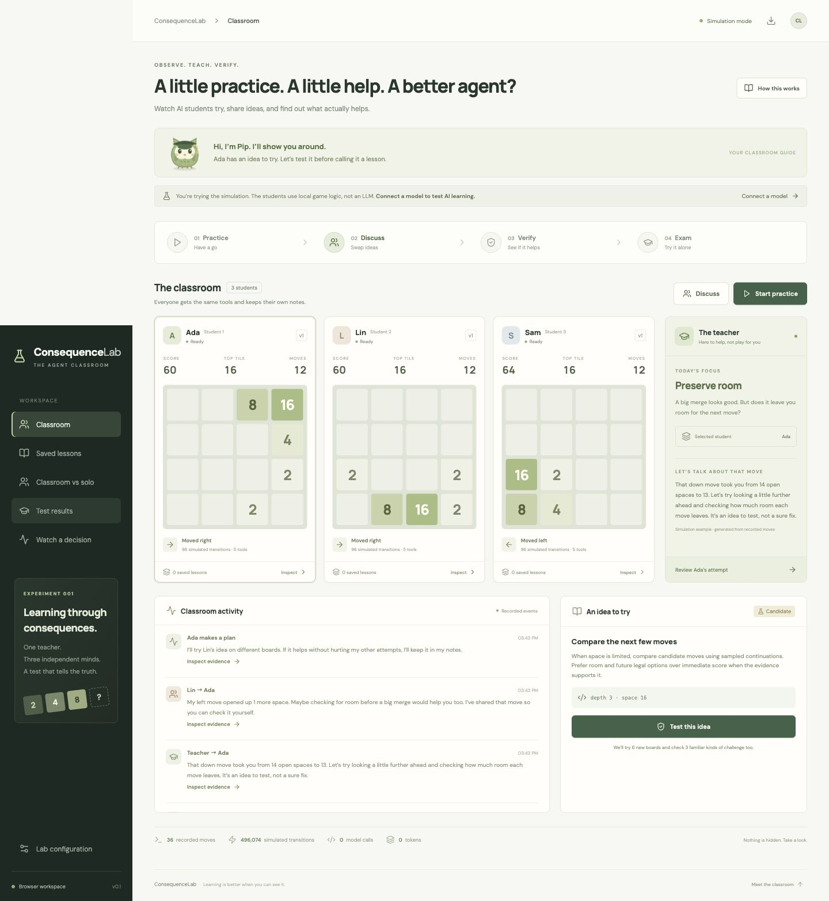

# ConsequenceLab

Meet **Pip**, the little owl who helps you follow a runnable agent classroom: seeded 2048, inspectable planning tools, teacher and peer feedback, candidate verification, versioned memory, independent exams, and a classroom-versus-solo pilot.



## Start locally

Requires Node.js 22.12+ (Node 22 LTS recommended) and npm.

```sh
npm ci
npm run dev
```

Open http://127.0.0.1:5173. The API listens on http://127.0.0.1:8787. Node's built-in SQLite is experimental on the tested Node 22 release; its startup warning is expected.

The **simulation works without credentials**. It uses a deterministic heuristic controller. Its explanations are rule-based and labeled as simulation. Peer evidence can change a proposed skill, but the same independent gate decides whether it is kept. Its outcomes must never be described as evidence of LLM learning.

## Connect Muse

```sh
cp .env.example .env
```

Set `MODEL_API_KEY` in `.env`, then restart `npm run dev` and reload the page. Choose **Lab configuration → Muse / model API**. Keys stay in the backend. Do not use a `VITE_` variable for credentials.

The configurable adapter defaults to `https://api.meta.ai/v1` and `muse-spark-1.3`, following Meta's Chat Completions and function-calling documentation checked October 27, 2026. Account access and live responses have **not** been validated because no key was supplied. No paid API calls were made during development.

- https://dev.meta.ai/docs/cookbook/quickstart-chat-completions
- https://dev.meta.ai/docs/cookbook/tool-function-calling

`MODEL_TOKEN_BUDGET` defaults to 100,000 per server process, shared by live student, teacher, peer, and verification calls. It reserves conservative prompt bytes plus the completion cap before each request, reconciles reported usage, and retains a reservation on unknown/failed usage. Resetting the classroom does not reset the provider budget. Restarting the server does. No automatic retries or simulated fallback conceal API failures.

## Walk through the prototype

1. **How this works** explains 2048 with an isolated human-playable board.
2. **Start practice** runs 12 moves per student and records actual tool outputs.
3. Select a student, then **Discuss** to produce an evidence-linked candidate.
4. **Test this idea** compares the candidate with the current workspace on six reachable practice snapshots and three regression snapshots. Acceptance is not guaranteed.
5. **Saved lessons** shows all outcomes, pairwise checks, provenance, and workspace rollback.
6. **Test results** freezes workspaces and runs fresh full games. It reports failures, caps, errors, and time-to-target.
7. **Watch a decision** shows before/after boards, exact tool results, and recorded episode replay. Replay makes no model calls.
8. **Classroom vs solo** runs fresh solo, teacher, and teacher+classmate groups, with real exchanges and separate exam outcomes. This small UI pilot is not a cost-matched research study.
9. **Export** downloads the complete JSON run. Simulation and model state are stored separately.

## Architecture

- `src/core/engine.ts`: pure 2048 transitions, seeded spawning, reachable snapshot collection.
- `src/core/skills.ts`: bounded executable `compare_escape_moves` skill, parameters, retrieval, memory gate.
- `src/core/policy.ts`: deterministic simulation controller and explicit rule-based review.
- `src/core/classroom.ts`: operation lock, phase transitions, practice/review/verify/exam, rollback.
- `src/core/evaluation.ts`: paired verification, independent episodes, honest outcome summaries.
- `server/model.ts`: server-only Chat Completions adapter and real model-selected function-call loop.
- `server/index.ts`: loopback HTTP API, SQLite persistence, SSE updates, process token accounting.
- `src/client.ts`: server transport, plus browser-local simulation fallback for static hosting.
- `src/App.tsx`, `src/styles.css`: React interface and responsive layouts.
- `scripts/evaluate.ts`: comparison runner and frozen-workspace ablations.

The engine was independently implemented; no original 2048 code or assets were copied. Game concept credit: Gabriele Cirulli, https://github.com/gabrielecirulli/2048 and https://play2048.co/. The UI is original. React, Vite, and Lucide remain under their respective package licenses.

## Tools and skills

Students can call `observe_board`, `retrieve_lessons`, `analyze_board`, `run_skill`, `simulate_moves`, and `apply_move`. The LLM chooses when to invoke tools; the server validates and executes them. Each move gets fresh context. Teachers and peers receive bounded, real trace excerpts and return evidence-checked proposals. In model mode, the recipient also generates a short plan for testing its classmate’s advice. The visible exchange names the sender and recipient.

Skills are a restricted procedure with versioned parameters, not arbitrary generated code. `compare_escape_moves` samples continuations with independent random streams, scores space/structure/merges/loss risk, and returns a ranking. The teacher may propose bounded parameter changes. Actual future spawns are never supplied to a policy.

Limits: 4 model calls and 12 tool calls per decision; 96 simulated transitions per decision; depth 1–4; up to 3 active lessons; 1,600 characters of active lesson rule/trigger/exception text. The character cap is explicit and is not advertised as an exact tokenizer count. Lesson retrieval currently supports `always` and `crowded boards` (at most six empty cells).

## Checks and evaluation

```sh
npm test
npm run build
npm run evaluate -- --seeds 2 --cap 1500 --out data/report.json
```

A completed simulation report is in `docs/simulation-evaluation.json`. It records the actual result, including zero 2048 wins where applicable. It is a software smoke benchmark, not a research finding.

For a model pilot, use small sizes deliberately:

```sh
npm run evaluate -- --mode model --seeds 1 --cap 100 --training-moves 4 --training-rounds 1 --token-budget 30000 --simulation-budget 10000 --out data/model-pilot.json
```

This command makes paid model calls using your configured account. It runs solo, teacher, and teacher+peer arms, followed by two classroom ablations. Each arm/repetition gets a fresh training provider and exam provider; each ablation gets a fresh provider. Therefore `--token-budget` is a **per-provider ceiling**, not an overall experiment ceiling (up to eight such providers per repetition). Start with a cost pilot and calculate the total before scaling.

The CLI uses identical ceilings, initial configurations, and paired exam seeds across conditions. It reports actual usage rather than pretending token consumption is exactly matched. Extra training compute can be spent on further practice. Repeated training runs are available with `--repetitions N`. Simulation arms share the same starting policy. In the classroom arm, a peer’s actual recorded example or verified skill can alter the candidate parameters. All candidates face the same gate; this demonstrates the software mechanism, not an LLM social-learning effect.

## Persistence and deployment

Local backend: `data/classroom.sqlite`, with WAL journaling. Runtime records and `.env` are ignored by Git and excluded from the handoff archive.

Hosted static build: browser-only simulation using localStorage. It has no live-model backend or server credentials. Export to preserve a run before clearing storage. Browser storage can reach its quota during long runs; use the local SQLite mode for substantial experiments.

```sh
npm run build
npm run preview
```

The Sites manifest is configured to publish `dist/` privately; publication was blocked in this session (see handoff). The Node backend is deliberately loopback-only and is not suitable for unauthenticated public deployment. See `docs/HANDOFF.md` for remaining work and acceptance criteria.
